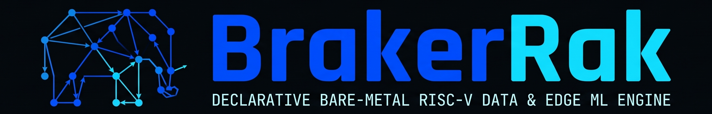

<div align="center">

  
  
  *...the Silicon is gonna Sing!*

</div>

---

`BrakerRak` (named in tribute to database pioneer [Michael Stonebraker](https://en.wikipedia.org/wiki/Michael_Stonebraker)) is a stateful bare-metal execution, diagnostic, and benchmarking harness designed to converge, profile, and orchestrate **Out-of-Order (`OoO`) vs. In-Order (`InO`) [RISC-V](https://riscv.org/) silicon** across high-throughput relational data brokering (`io_uring` PostgreSQL 18.6), Edge NPU ML, and discrete PCIe AI accelerators (Tenstorrent Blackhole / GPUs).

## Ecosystem Layering: `RVDK` vs. `BrakerRak`

`BrakerRak` is intentionally architected as a higher-order R&D harness atop **[`riscv-data-kit` (`RVDK`)](https://github.com/drewv-labs/riscv-data-kit)** and **[`CarrierPigeons`](https://github.com/drewv-labs/carrierpigeons)** (**HamStak**) so neither layer compromises the other:

| Layer | Project | What It Owns | Who Should Start Here |
| :--- | :--- | :--- | :--- |
| **Foundation** *(Stateless Primitives)* | **[`riscv-data-kit`](https://github.com/drewv-labs/riscv-data-kit)** (`rvdk`) | A-la-carte Day-0 OS normalization, vendor DTB/U-Boot protection, hardware PMU unlock, multi-layer `deeptune`, board `quirks`, host media flashers, and individual service/storage modules (`4Kn` NVMe, Btrfs RAID 10, NFSv4/Ganesha, Mosquitto, Tailscale, prebuilt/source PG 18.6). | Engineers who want to plug individual RISC-V provisioning or tuning modules into their own workflow/CI **without** adopting the `BrakerRak` stack. |
| **Execution & Lab Harness** *(Stateful Science)* | **`BrakerRak`** (`brakerrak`) | **Two-Axis State Machine (`Targets × Roles`)**, multi-pass `~/.brakerrak/node.env` convergence, stateless persona flipping (`databroker` / `braksky` / `databench` / `visionferret` / `devbench` / `devsky`), signed **ORT & CTD** hardware provenance manifests, 5-stage idempotency verification, Day-0 `512e` factory rollback, cold-cache **PostgreSQL 18.6 `io_uring`** torture benchmarks, and **`CarrierPigeons`** (`HamStak`) telemetry orchestration. | Homelabbers, systems researchers, and hardware benchmarkers seeking a turnkey, reproducible RISC-V data & AI laboratory. |

---

## Two-Axis Architecture: `Targets` × `Roles`

### 1. Role Personas (`roles/` & `node.env`)

Flip any supported RISC-V node statelessly between production data brokering, discrete GPU/Blackhole AI compute, isolated microarchitectural benchmarking, or Edge NPU development via `sudo brakerrak --role <persona> --deeptune`:

| Role Persona | Default Hostname | `RVDK` DeepTune Profile | PostgreSQL 18.6 (`io_uring`) | Mosquitto MQTT (`:1883`) | NFSv4 Vault Server (`ganesha` / `kernel`) | `CarrierPigeons` (`HamStak`) Role |
| :--- | :--- | :--- | :--- | :--- | :--- | :--- |
| **`databroker`** | `brakerbox-<tag>` | `--tune data` | Active + Warm/Cold RAID Tablespaces | Enabled (Persisted on `4Kn` NVMe) | Exports RAID Vaults (or `${MOUNT_POINT}/nfs_vault` when `WITH_RAID=false`) | `PigeonCoop` + `Pigeoneer` |
| **`braksky`** | `braksky-<tag>` | `--tune ai` | Disabled by Default (`--with-pg` opt-in; frees RAM/HugePages for Blackhole/GPU) | Disabled | Disabled | `PigCan` + `Pigeoneer` |
| **`databench`** | `brakerbench-<tag>` | `--tune data` | Active (Isolated Benchmark Target) | Disabled for Benchmark Isolation | Disabled for Benchmark Isolation | `Pigeoneer` Only |
| **`visionferret`** | `vferret-<tag>` | `--tune ml` | Disabled by Default (`--with-pg` opt-in; pure Edge NPU isolation) | Disabled for Benchmark Isolation | Disabled for Benchmark Isolation | `Pigeoneer` Only |
| **`devbench`** | `devbench-<tag>` | `--tune ml` | Active (Edge NPU ML + Edge Data Bench) | Enabled (`:1883` + Unix Socket) | Disabled by Default | `Pigeoneer` Only |
| **`devsky`** | `devsky-<tag>` | `--tune ai` | Active (Discrete GPU/Blackhole ML + High-Mem Data Bench) | Enabled (`:1883` + Unix Socket) | Disabled by Default | `Pigeoneer` Only |

### 2. Silicon Targets (`soc-drawer/`)

| SoC / Board | Core Complex & Pipeline | ISA Profile & Compiler Flags | Status |
| :--- | :--- | :--- | :--- |
| ESWIN EIC7700X (HiFive Premier P550 / Milk-V Megrez) | `4x SiFive P550` (`3-Wide OoO @ 1.4–1.8GHz`) | `RVA20` (`-O3 -march=rv64gc_zba_zbb -mcpu=sifive-p550`) | **Active / Verified** |
| StarFive JH7110 / JH7110S (VF2 / VF2 Lite / Mars / OPi RV) | `4x SiFive U74` (`2-Wide InO @ 1.25–1.5GHz`) | `RVA20` (`-O3 -march=rv64gc -mcpu=sifive-u74`) | **Active / Verified** |
| SpacemiT K1/M1 (OPi RV2 / OPi R2S / Jupiter / BPI-F3 / CM6) | `8x SpacemiT X60` (`2-Wide InO @ 1.6–1.8GHz`) | `RVA22` + `256-bit RVV 1.0` | **Active / Bring-Up** |
| UltraRISC UR-DP1000 (Milk-V Titan) | `8x UR-CP100` (`4-Wide OoO @ 2.0GHz` + `PCIe Gen4 x16`) | `RVA22` + `H-Ext 1.0` | **Active / Bring-Up** |
| SpacemiT K3 (Milk-V Jupiter 2 / Firefly AIBOX-K3) | `8x SpacemiT X100` (`4-Wide OoO @ 2.4GHz` + `60 TOPS`) | `RVA23` + `1024-bit RVV 1.0` | Planned |
| SiFive Freedom U740 (HiFive Unmatched Rev B) | `4x SiFive U74` (`2-Wide InO @ 1.2GHz` + `PCIe Gen3 x8`) | `RVA20` (`RV64GC`) | Planned |
| Tenstorrent Atlantis | `8x Tenstorrent Ascalon-X` (`Wide OoO` + `PCIe Gen5`) | `RVA23` + `256-bit RVV 1.0` | Planned |

---

## Repository Structure

All node-specific state (`~/.brakerrak/node.env`) and generated hardware provenance manifests (`~/.brakerrak/snapshots/`) live outside the repository tree so the engine remains stateless:

```text
brakerrak/
├── README.md
├── forge.sh                             # Config-driven RVDK harness orchestrator & `/usr/local/bin/brakerrak` CLI
├── install-cli.sh                       # Standalone CLI & engine installer (~/.brakerrak/engine)
├── roles/
│   ├── databroker.env                   # BrakerBox persona defaults (Prod Data Broker: PG18 + MQTT + NFSv4)
│   ├── braksky.env                      # BrakSky persona defaults (Prod GPU/Blackhole ML Forge + PigCan)
│   ├── databench.env                    # BrakerBench persona defaults (Isolated Pure Data PG18 testbed)
│   ├── visionferret.env                 # VisionFerret persona defaults (Isolated Pure Edge NPU ML testbed)
│   ├── devbench.env                     # DevBench persona defaults (Edge NPU ML + Edge Data Bench)
│   └── devsky.env                       # DevSky persona defaults (Discrete GPU/Blackhole ML + Data Bench)
├── soc-drawer/
│   ├── eswin-eic7700x/ort-snapshot.py   # Stage 0 & 3: Zero-dependency ORT & CTD manifest generator (P550/Megrez)
│   ├── starfive-jh7110/ort-snapshot.py  # Stage 0 & 3: Zero-dependency ORT & CTD manifest generator (JH7110/JH7110S)
│   └── generic-riscv64/ort-snapshot.py  # Stage 0 & 3: Silicon-profiled ORT & CTD collector (K1/K3/DP1000/FU740/Atlantis)
├── benchmarks/
│   ├── seed-io-torture.sh               # Deterministic 50M-row `brakerrak_io_torture` parallel generator
│   └── run-iouring-showdown.sh          # Cold-cache 3-way `sync` vs `worker` vs `io_uring` benchmark harness
├── scripts/
│   ├── lib-progbar.sh                   # 2-row stacked VT100 progress dock (BrakerRak master + RVDK sub-bar)
│   ├── ort-snapshot.sh                  # Auto-detects SoC and dispatches soc-drawer/<target>/ort-snapshot.py
│   ├── verify-convergence.sh            # End-to-end 5-stage convergence & idempotency verification harness
│   └── reset-day0.sh                    # Option A: Destructive 512e NVMe & Day-0 factory rollback
├── docs/                                # Hardware layouts, build logs & thermal characterization studies
└── examples/
    ├── databroker-raid.env.example      # Reference multi-array Btrfs RAID 10 databroker configuration
    └── databench.env.example            # Reference isolated databench configuration
```

---

## Zero-Touch Quickstart (`curl | sudo bash` & `brakerrak` CLI)

### 1. Remote One-Liner Convergence

`BrakerRak`'s root `forge.sh` reads `/etc/rvdk/kit.env` (or probes `/proc/device-tree/model`), installs/updates `/usr/local/bin/brakerrak` and `/usr/local/bin/rvdk`, generates `~/.brakerrak/node.env` on Pass 1, and orchestrates the full `RVDK` convergence pipeline (formatting secondary NVMe to `4Kn` with `vg_braker` LVM + `15%VG` CoW snapshot reserve, converging role-gated PostgreSQL 18.6 / MQTT / NFSv4 services, and applying workload-matched `rvdk deeptune`):

```bash
# Install the brakerrak CLI & engine without running the convergence forge
curl -fsSL https://brakerrak.dev/install-cli.sh | sudo bash

# Converge node as a BrakerBox DataBroker (default Pass 1 role: databroker, NVMe-only)
curl -fsSL https://brakerrak.dev/forge.sh | sudo bash -s -- --role databroker --deeptune

# Converge node as an isolated BrakerBench testbed or DevSky GPU/Blackhole bench
curl -fsSL https://brakerrak.dev/forge.sh | sudo bash -s -- --role databench --deeptune
curl -fsSL https://brakerrak.dev/forge.sh | sudo bash -s -- --role devsky --deeptune
```

### 2. Local `/usr/local/bin/brakerrak` Lifecycle & Stateless Persona Flipping

Once bootstrapped, use `brakerrak` to flip node personas statelessly (e.g., staging a `DevSky-Titan` bench and flipping it into `BrakSky-Titan` production), apply role-mapped `RVDK` DeepTune profiles, capture signed ORT/CTD hardware snapshots, verify idempotency, run `io_uring` showdowns, or roll back to factory Day-0 state:

```bash
# Re-converge node from ~/.brakerrak/node.env (Pass 2) or flip node persona on the fly
sudo brakerrak
sudo brakerrak --role devsky --deeptune
sudo brakerrak --role braksky --deeptune
sudo brakerrak --role databench --deeptune
sudo brakerrak --role databroker --with-tailscale --ts-ssh

# Apply or inspect role-aware RVDK DeepTune (`databroker`/`databench` -> data, `devbench`/`visionferret` -> ml, `braksky`/`devsky` -> ai)
sudo brakerrak deeptune
sudo brakerrak deeptune status

# Capture a read-only Operational Readiness Test (ORT) & SHA-256 CTD snapshot in ~/.brakerrak/snapshots/
sudo brakerrak ort --stage day1-post-forge

# Execute the full 5-stage Day-0 -> Day-1 convergence & idempotency verification harness
sudo brakerrak verify --use-pkg-cache

# Seed the 50M-row torture table & run the cold-cache PG 18.6 sync vs worker vs io_uring showdown
sudo ~/.brakerrak/engine/benchmarks/seed-io-torture.sh
sudo ~/.brakerrak/engine/benchmarks/run-iouring-showdown.sh

# Roll back NVMe to factory 512e (512B) LBA sectors and scrub PG18/service state (preserving .deb cache)
sudo brakerrak reset --confirm-destroy --keep-pg-cache

# Pull latest RVDK + BrakerRak engines from GitHub
sudo brakerrak update
```

---

## Declarative Node Configuration (`~/.brakerrak/node.env`)

On **Pass 1**, `forge.sh` converges the core OS, `4Kn` NVMe (`vg_braker/lv_pgdata`), and role-selected services using safe single-NVMe defaults (`WITH_RAID="false"`) and writes `~/.brakerrak/node.env`.

To attach external USB/SATA Btrfs RAID 10 vaults or customize network exports for **Pass 2**, populate `RAID_ARRAYS_JSON` in `~/.brakerrak/node.env` and re-run `sudo brakerrak`:

```bash
NODE_ROLE="databroker"
TARGET_HOSTNAME="brakerbox-p550"
ADMIN_USER="drew"
LAB_SUBNET="10.0.10.0/24"
RVDK_TUNE_PROFILE="data"
PIGEON_ROLE="pigeoncoop+pigeoneer"

NVME_DEV="/dev/nvme0n1"
MOUNT_POINT="/mnt/nvme_pgdata"

WITH_RAID="true"
RAID_ARRAYS_JSON='[
  {
    "name": "WarmVault",
    "id": "warmvault",
    "type": "warm",
    "label": "WARM_VAULT",
    "mount": "/mnt/warm_vault",
    "md_dev": "/dev/md/warmvault",
    "disks": 4,
    "min_bytes": 11000000000000,
    "max_bytes": 13000000000000,
    "tablespace": "ts_warm_vault",
    "nfs_fsid": 10,
    "nfs_dirs": ["models", "sigmf", "fits", "pg_backups", "ctd-vault"]
  }
]'

ENABLE_POSTGRES="true"
ENABLE_MQTT_BROKER="true"
MQTT_PORT="1883"
ENABLE_NFS_SERVER="true"
NFS_BACKEND="ganesha"
```

When `WITH_RAID="true"`, `BrakerRak` passes `RAID_ARRAYS_JSON` into `rvdk mods/btrfs-raid` and `rvdk mods/nfs-vault` to:
1. Match unmounted rotational candidate disks by byte-capacity bounds and assemble native kernel Btrfs RAID 10 volumes (`compress=zstd:3,nofail`).
2. Register each array's PostgreSQL tablespace (`ts_warm_vault`, etc.) and scaffold shared `nfs_dirs`.
3. Export vaults over NFSv4 via userspace `nfs-ganesha` (`FSAL_VFS`, safe even on vendor kernels lacking `CONFIG_NFSD`) or kernel `nfsd` (`--nfs-kernel`), falling back to `${MOUNT_POINT}/nfs_vault` when `WITH_RAID="false"`.
4. Assert disk enumeration and mount health inside `ort-snapshot.py` while redacting physical drive serial numbers to `"REDACTED"` in companion `.public.json` manifests.

---

## Deterministic 5-Stage Lifecycle State Machine (`brakerrak verify`)

1. **Stage 0 — Clean-Room ORT Baseline (`brakerrak ort --stage day0-pre-forge`):** Captures a zero-mutation JSON snapshot of factory PCIe link speeds, `512e` NVMe LBA formatting, rotational JBOD enumeration, and quiescent thermal/clock baselines.
2. **Stage 1 — Cold Convergence Forge (`brakerrak forge`):** Dispatches `rvdk day0`, `rvdk mods/nvme-4kn` (`vg_braker` @ `85%VG`), role-gated `rvdk postgresql` (prebuilt `.tar.zst` or `--force-rebuild-pg` cold compile under `perf stat`), optional `rvdk mods/btrfs-raid`, role-gated `mosquitto` / `nfs-vault`, and `rvdk deeptune`.
3. **Stage 2 — Idempotency Verification Pass (`brakerrak forge`):** Re-executes the full pipeline against the live node, asserting `100% [SKIP]` across converged stages with zero destructive storage mutations or unnecessary `apt-get update` passes.
4. **Stage 3 — Post-Forge CTD Provenance (`brakerrak ort --stage day1-post-forge`):** Emits a SHA-256 signed JSON manifest (`.json` + redacted `.public.json`) to `~/.brakerrak/snapshots/` verifying `4Kn` block alignment, active `io_uring` backend configuration, `Sv39` HugePage consumption, and tablespace/NFSv4 routing.
5. **Option A Rollback (`brakerrak reset --confirm-destroy`):** Tears down services and LVM volumes, hardware-reformats the NVMe back to factory `512e` (`512B`) LBA sectors, and scrubs Day-1 state for repeatable clean-room testing.

---

###### Trademarks & Non-Affiliation Notice
> **BrakerRak** is an independent open-source project developed and maintained by **DREW-V Labs** and is not affiliated with, endorsed by, or sponsored by **RISC-V International**, the **Linux Foundation**, the **RISE Project**, **SiFive**, **Tenstorrent**, **StarFive**, **Milk-V**, **SpacemiT**, **UltraRISC**, or **Orange Pi**. "RISC-V" is a registered trademark of RISC-V International. All other product names, logos, and brands are property of their respective owners and are used strictly for identification and hardware compatibility purposes under nominative fair use.

---

<div align="center">

**DREW-V LABS** // **Drew Vandagriff** — *Dallas, TX*  
`Simplicity in Architecture · Efficiency in Engineering · Purity in Science · Audacity in Art · Life in Logic`

</div>
