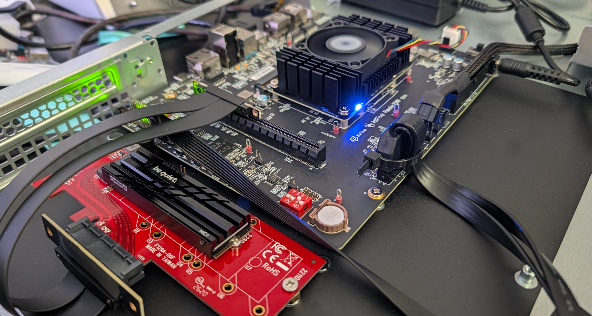
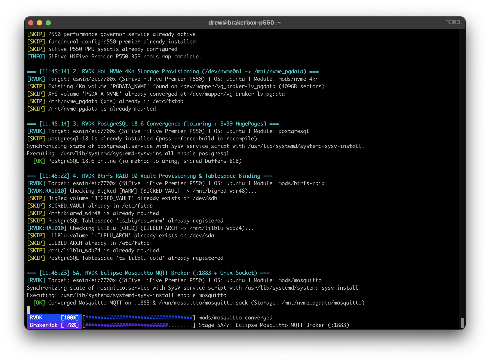

<div align="center">

  

  Unshackle *the world's most advanced open source database* for *the future of compute*...

</div>

---

As a R&D platform, BrakerRak's core objectives are to streamline tuning and benchmark data systems & hardware accelerators across current [RISC-V](https://en.wikipedia.org/wiki/RISC-V) hardware offerings with scientific rigor.

BrakerRak is designed around **Tech Stack Focus Anchors** and a **Dual-Axis Architecture** to help manage sterile test environments and organize, deploy, & capture experiments in high resolution.

---

## Tech Stack Focus Anchors

### Data System Focus Anchors

> Current **Data System Focus Anchors** represent the default choices used by BrakerRak. These focus anchors are not an exhaustive list of various data systems software supported and used by BrakerRak as the aim is to grow into a rich RISC-V Data Systems & AI/ML ecosystem.

**[PostgreSQL](https://www.postgresql.org/)**<br>
Named in tribute to database pioneer [Michael Stonebraker](https://en.wikipedia.org/wiki/Michael_Stonebraker), BrakerRak's primary core objective is accelerating latest versions of **PostgreSQL** on RISC-V bare-metal silicon. At the edge or in a server rack, BrakerRak is dedicated to rigorous, deep **PSQL** systems benchmarking & analysis toward studying how **PSQL** performs across various RISC-V profiles & ratifications, compiling optimized [riscv64 builds of the latest PSQL versions & features](https://github.com/drewv-labs/riscv-data-kit/releases), and setting up RISC-V nodes as [PSQL Buildfarms](https://wiki.postgresql.org/wiki/PostgreSQL_Buildfarm_Howto). 

**[NFS-Ganesha](https://github.com/nfs-ganesha/nfs-ganesha)**<br>
Operating as a versatile userspace NFS system, **NFS-Ganesha** is the BrakerRak NFS standard. **Ganesha's** major super power for an R&D system is that it's shielded from crusty vendor BSP kernel modules across the variety of RISC-V boards out in the wild. Also... more elephants! NFSv4 kernel system is supported by BrakerRak via optional flags and config.

### Hardware Accelerator Focus Anchors

> Current **Hardware Accelerator Focus Anchors** represent phase 1 development anchors while project matures to ensure performance observations are captured accurately across silicon in a controlled manner with ongoing hardware accelerator support expansion to come.

**[Hailo AI Accelerators](https://hailo.ai/products/ai-accelerators/)**<br>
The **Hailo-8** (26 TOPS) and **Hailo-8L** (13 TOPS) M.2 NVMe NPU modules provide astounding power per watt making them word class accelerators for int8 or int4 operations. The *Hailo-10H* is rated at 40 TOPS int4 (20 TOPS int8) with 8gb onboard memory. As such, the *Hailo* *8* and *10* series modules are the NPU Accelerator Focus Anchor.   

**[Tenstorrent Blackhole p150 Accelerators](https://tenstorrent.com/hardware/cards)**<br>
Powered by 120 Tensix RISC-V compute tiles (600 RV32 baby harts driving 120 AI coprocessors) plus 16 coherent SiFive X280 RV64 harts & 32GB GDDR6 onboard memory, **Tenstorrent's Blackhole p150** card will serve as the PCIe GPU Accelerater Focus Anchor. Note: *p150a* (active cooled) units used in development.

---

## Dual-Axis Architecture: Roles x Targets

</div>

### 1. Role Personas (`roles/` & `node.env`)

Flip any supported RISC-V node statelessly between production data brokering, discrete GPU/Blackhole AI compute, Edge NPU inference, isolated microarchitectural benchmarking, or hybrid development via `brakerrak --role <persona> --deeptune`:

| Role (--role) | RVDK DeepTune | PostgreSQL 18.6 (io_uring) | Mosquitto MQTT (:1883) | NFSv4 Vault Server (ganesha / kernel) | Desc |
| :--- | :--- | :--- | :--- | :--- | :--- |
| **databroker** | --tune data | Active + Warm/Cold RAID Tablespaces | Enabled (Persisted on 4Kn NVMe) | Exports RAID Vaults (or Dedicated lv_nfsvault Btrfs LV when WITH_RAID=false) | Prod Data Broker & NFS Host |
| **databench** | --tune data | Active (Isolated Benchmark Target) | Disabled for Benchmark Isolation | Disabled for Benchmark Isolation | Dev Data Bench |
| **babbagebox** | --tune ai | Disabled by Default (--with-pg opt-in; frees RAM/HugePages for Blackhole/GPU) | Disabled | Disabled | Prod GPU / Blackhole Workhorse + PigCan |
| **babbagebench** | --tune ai | Disabled by Default (--with-pg opt-in; pure GPU/Blackhole isolation) | Disabled for Benchmark Isolation | Disabled for Benchmark Isolation | Dev Isolated GPU / Blackhole Bench |
| **visionbox** | --tune ai | Disabled by Default (--with-pg opt-in; full Edge NPU memory headroom) | Disabled | Disabled | Prod Edge NPU Inference Node |
| **visionbench** | --tune ai | Disabled by Default (--with-pg opt-in; pure Edge NPU isolation) | Disabled for Benchmark Isolation | Disabled for Benchmark Isolation | Dev Isolated Edge NPU Bench |
| **devbench** | --tune ai | Active (Hybrid GPU/NPU + Data Bench) | Enabled (:1883 + Unix Socket) | Disabled by Default | Dev Hybrid Bench (Hot-Swappable Roles & Tunes) |


### 2. Silicon Targets (`soc-drawer/`)

| SoC / Board | Core Complex & Pipeline | ISA Profile & Compiler Flags | Status |
| :--- | :--- | :--- | :--- |
| ESWIN EIC7700X (HiFive Premier P550 / Milk-V Megrez) | 4x SiFive P550 (3-Wide OoO @ 1.4–1.8GHz) | RVA20 (-O3 -march=rv64gc_zba_zbb -mcpu=sifive-p550) | **Active / Verified** |
| StarFive JH7110 / JH7110S (VF2 / VF2 Lite / Mars / OPi RV) | 4x SiFive U74 (2-Wide InO @ 1.25–1.5GHz) | RVA20 (-O3 -march=rv64gc -mcpu=sifive-u74) | **Active / Verified** |
| SpacemiT K1/M1 (OPi RV2 / OPi R2S / Jupiter / BPI-F3 / CM6) | 8x SpacemiT X60 (2-Wide InO @ 1.6–1.8GHz) | RVA22 + 256-bit RVV 1.0 | **Active / Bring-Up** |
| UltraRISC UR-DP1000 (Milk-V Titan) | 8x UR-CP100 (4-Wide OoO @ 2.0GHz + PCIe Gen4 x16) | RVA22 + H-Ext 1.0 | **Active / Bring-Up** |
| SpacemiT K3 (Milk-V Jupiter 2 / Firefly AIBOX-K3) | 8x SpacemiT X100 (4-Wide OoO @ 2.4GHz + 60 TOPS) | RVA23 + 1024-bit RVV 1.0 | Planned |
| SiFive Freedom U740 (HiFive Unmatched Rev B) | 4x SiFive U74 (2-Wide InO @ 1.2GHz + PCIe Gen3 x8) | RVA20 (RV64GC) | Planned |
| Tenstorrent Atlantis | 8x Tenstorrent Ascalon-X (Wide OoO + PCIe Gen5) | RVA23 + 256-bit RVV 1.0 | Planned |

---

<div align="center">



*HiFive Premier P550 1U [BrakerBox-P550](https://github.com/drewv-labs/brakerrak/blob/main/docs/builds/brakerbox-p550.md) build*

</div>

---

## Ecosystem Layering

[RVDK (riscv-data-kit)](https://github.com/drewv-labs/riscv-data-kit) 

Provides the foundational RISC-V idempotent day-0 media flashers, bare-metal bootstrappers, multi-layer kernel tuners, & prebuilt package catalog. BrakerRak leverages **RVDK** to deterministically provide controlled test environments, hot-swappable system tuning (data brokering vs ML use cases), and exposes performance metric interfaces, e.g., `perf` counters, for CarrierPigeons to tap into.   

[CarrierPigeons](https://github.com/drewv-labs/carrierpigeons)
<!-- TODO: Swap the CTD link below to the dedicated CTD architecture writeup URL once published -->

Provides a configurable Go-driven **Continuous Telemetric Documentation (CTD)** mesh, distributed systems orchestration plane, **Runner** dispatch, analytics layer, AI powered diagnostics & support, and an MCP service that can be plugged into modern agent harnesses. 

> The lightweight high-throughput **CTD** mesh provides passive hardware-bound wide event observability that captures deep system measurements without interferring with latency sensitive experiments and delivers document blobs to the unified *PSQL-powered* **CTD Ledger** over *MQTT network*. Collects and streams bare-metal metric readings from each node with minimal observer effects creating clean, reliabale systems information that's immediately ready for insight mining or deep systems analysis. 

> **CarrierPigeons** also provides a distributed systems orchestration platform to reduce friction of managing a R&D cluster so we can spend more time on the science & engineering. 

> Tap into **CarrierPigeon's** **Runner** system to deploy prebuilt Go or ephemeral shell/Python executable functions to a single node or batch tagged groups or chained combinations, a real cheatcode for tasks like cluster maintenance or organizing selective multi-node benchmarks.  

> Collecting data is one piece of the puzzle, **PigeonMath** provides the analytics layer, interface, and toolkit to expand **CTD Ledger** analysis to your specific use case. Use **PigeonMath** to develop certified views to feed custom analytic pipelines or to enrich AI Agent support & diagnostic context. **PigeonMath** also constructs live system DAGs to model your cluster and provide layered lenses to explore your system and data.

> Having a context-aware AI buddy to help diagnose issues, provide insights around abnormal node metrics, or to run an ad-hoc ephemeral Runner on your behalf can help keep focus on the science and engineering or to provide support when sh!t hits the fan. **PigeonCare** is here for us all!

> Lastly, **CarrierPigeons** gives us a *MCP service* allowing devs & researchers to plug their favorite harnesses and tools directly to the mesh. Work in the environment you're most comfortable with and empowered by. 

---

## Ask your doctor if BrakerRak is right for you!

While BrakerRak provides the complete package, devs may only be interested in specific aspects to integrate into their worflows and applications.

* **Use [RVDK](https://github.com/drewv-labs/brakerrak) standalone** if you want unopinionated building blocks—plugging Day-0 OS de-bloating, safe vendor DTB/U-Boot upgrades, `deeptune` kernel tuning, `4Kn` NVMe formatting, or prebuilt `io_uring` PostgreSQL 18.6 directly into your own scripts, Ansible playbooks, or CI pipelines without adopting an external stack.

* **Use [CarrierPigeons](https://github.com/drewv-labs/carrierpigeons) standalone** if you want a lightweight-but-mighty Go-powered distributed telemetry, orchestration, execution, and analytics suite with baked in AI Agent + MCP power. Note: **CarrierPigeons** is designed to run on and support heterogenous architectures, **CarrierPigeons is not RISC-V exclusive** like **RVDK** and **BrakerRak** are designed to be.

* **Use [`BrakerRak`](https://github.com/drewv-labs/brakerrak) (`brakerrak`)** if you want the full turnkey bare-metal RISC-V data systems, telemetry, & edge AI R&D engine combining the might of **RVDK** & **CarrierPigeons**. Note: **BrakerRak**, while designed to be a R&D platform, can easily be used to converge production ready machines deterministically & idempotently making it a great tool for provisioning reliable & performant RISC-V data brokers & AI systems into production.

<div align="center">



</div>

---

<div align="center">

## BrakerRak Quickstart (`curl | sudo bash` & `brakerrak` CLI)

</div>

### 1. Remote One-Liner Convergence

**BrakerRak's** root `forge.sh` reads `/etc/rvdk/kit.env` (or probes `/proc/device-tree/model`), installs/updates `/usr/local/bin/brakerrak` and `/usr/local/bin/rvdk`, generates `~/.brakerrak/node.env` on Pass 1, and orchestrates the full **RVDK** convergence pipeline (formatting secondary NVMe to `4Kn` with `vg_braker` LVM, converging role-gated PostgreSQL 18.6 / MQTT / NFSv4 services, and applying workload-matched `rvdk deeptune`):

```bash
# Install the brakerrak CLI & engine without running the convergence forge
curl -fsSL https://brakerrak.dev/install-cli.sh | sudo bash

# Converge node as a BrakerBox DataBroker (default Pass 1 role: databroker, NVMe-only)
curl -fsSL https://brakerrak.dev/forge.sh | sudo bash -s -- --role databroker --deeptune

# Converge node as an isolated BrakerBench testbed, BabbageBox GPU workhorse, or hybrid DevBench
curl -fsSL https://brakerrak.dev/forge.sh | sudo bash -s -- --role databench --deeptune
curl -fsSL https://brakerrak.dev/forge.sh | sudo bash -s -- --role babbagebox --deeptune
curl -fsSL https://brakerrak.dev/forge.sh | sudo bash -s -- --role devbench --deeptune
```

### 2. Local `/usr/local/bin/brakerrak` Lifecycle & Stateless Persona Flipping

Once bootstrapped, use `brakerrak` CLI to flip node personas statelessly (e.g., staging a `DevBench-TitanP150A` / `BabbageBench-TitanP150A` bench and flipping it into `BabbageBox-TitanP150A` production), manage live Dual-LVM storage elasticity, apply role-mapped **RVDK DeepTune** profiles, capture signed ORT/CTD hardware snapshots, verify idempotency, run showdowns, or roll back to factory Day-0 state:

```bash
# Re-converge node from ~/.brakerrak/node.env (Pass 2) or flip node persona on the fly
brakerrak
brakerrak --role devbench --deeptune
brakerrak --role babbagebench --deeptune
brakerrak --role babbagebox --deeptune
brakerrak --role visionbench --deeptune
brakerrak --role databench --deeptune
brakerrak --role databroker --with-tailscale --ts-ssh

# Apply or inspect role-aware RVDK DeepTune (`databroker`/`databench` -> data, `babbage*`/`vision*`/`devbench` -> ai)
brakerrak deeptune
brakerrak deeptune status

# Inspect or rebalance live vg_braker Dual-LVM extents online (`lv_pgdata` XFS + `lv_nfsvault` Btrfs)
brakerrak storage status
brakerrak storage grow-psql --gb 100
brakerrak storage grow-nfs --mb 500
brakerrak storage autotune

# Capture a read-only Operational Readiness Test (ORT) & SHA-256 CTD snapshot in ~/.brakerrak/snapshots/
brakerrak ort --stage day1-post-forge

# Execute the full 5-stage Day-0 -> Day-1 convergence & idempotency verification harness
brakerrak verify --use-pkg-cache

# Seed the 50M-row torture table & run the cold-cache PG 18.6 sync vs worker vs io_uring showdown
~/.brakerrak/engine/benchmarks/seed-io-torture.sh
~/.brakerrak/engine/benchmarks/run-iouring-showdown.sh

# Roll back NVMe to factory 512e (512B) LBA sectors and scrub PG18/service state (preserving .deb cache)
brakerrak reset --confirm-destroy --keep-pg-cache

# Pull latest RVDK + BrakerRak engines from GitHub
brakerrak update
```

---

<div align="center">

## Declarative Node Configuration (`~/.brakerrak/node.env`)

</div>

On **Pass 1**, `forge.sh` converges the core OS, `4Kn` NVMe (`vg_braker/lv_pgdata` + `vg_braker/lv_nfsvault` on single-NVMe NFS builds), and role-selected services using safe single-NVMe defaults (`WITH_RAID="false"`) and writes `~/.brakerrak/node.env`.

To attach external USB/SATA Btrfs RAID 10 vaults or customize network exports for **Pass 2**, populate `RAID_ARRAYS_JSON` in `~/.brakerrak/node.env` and re-run `sudo brakerrak`:

```bash
NODE_ROLE="databroker"
TARGET_HOSTNAME="brakerbox-p550"
ADMIN_USER="drew"
LAB_SUBNET="10.0.10.0/24"
RVDK_TUNE_PROFILE="data"

NVME_DEV="/dev/nvme0n1"
MOUNT_POINT="/mnt/nvme_pgdata"
NFS_MOUNT_POINT="/mnt/nfs_vault"

WITH_RAID="true"
RAID_ARRAYS_JSON='[
  {
    "name": "WarmVault",
    "id": "warmvault",
    "type": "warm",
    "label": "WARM_VAULT",
    "mount": "/mnt/warm_vault",
    "md_dev": "/dev/md/warmvault",
    "disks": 4,
    "min_bytes": 11000000000000,
    "max_bytes": 13000000000000,
    "tablespace": "ts_warm_vault",
    "nfs_fsid": 10,
    "nfs_dirs": ["models", "sigmf", "fits", "pg_backups", "ctd-vault"]
  }
]'

ENABLE_POSTGRES="true"
ENABLE_MQTT_BROKER="true"
MQTT_PORT="1883"
ENABLE_NFS_SERVER="true"
NFS_BACKEND="ganesha"
```

When `WITH_RAID="true"`, `BrakerRak` passes `RAID_ARRAYS_JSON` into `rvdk mods/btrfs-raid` and `rvdk mods/nfs-vault` to:

1. Match unmounted rotational candidate disks by byte-capacity bounds and assemble native kernel Btrfs RAID 10 volumes (`compress=zstd:3,nofail`).  

2. Register each array's PostgreSQL tablespace (`ts_warm_vault`, etc.) and scaffold shared `nfs_dirs`.  

3. Export vaults over NFSv4 via userspace `nfs-ganesha` (`FSAL_VFS`, safe even on vendor kernels lacking `CONFIG_NFSD`) or kernel `nfsd` (`--nfs-kernel`), falling back to the dedicated `lv_nfsvault` Btrfs LV (`${NFS_MOUNT_POINT}`) when `WITH_RAID="false"`.

4. Assert disk enumeration and mount health inside `ort-snapshot.py` while redacting physical drive serial numbers to `"REDACTED"` in companion `.public.json` manifests.

---

<div align="center">

## Deterministic 5-Stage Lifecycle State Machine (`brakerrak verify`)

</div>

1. **Stage 0 — Clean-Room ORT Baseline (`brakerrak ort --stage day0-pre-forge`):** 

Captures a zero-mutation JSON snapshot of factory PCIe link speeds, `512e` NVMe LBA formatting, rotational JBOD enumeration, and quiescent thermal/clock baselines.
<br>

2. **Stage 1 — Cold Convergence Forge (`brakerrak forge`):**

Dispatches 
* `rvdk day0`
* `rvdk mods/nvme-4kn` (`vg_braker` Dual-LVM or `85%VG`)
* role-gated `rvdk postgresql` (prebuilt `.tar.zst` or `--force-rebuild-pg` cold compile under `perf stat`), 
* optional `rvdk mods`:
  * `mosquitto`
  * `nfs-vault`
  * `btrfs-raid`
  * `rvdk deeptune`
<br>

3. **Stage 2 — Idempotency Verification Pass (`brakerrak forge`):** 

Re-executes the full pipeline against the live node, asserting `100% [SKIP]` across converged stages with zero destructive storage mutations or unnecessary `apt-get update` passes.
<br>

4. **Stage 3 — Post-Forge CTD Provenance (`brakerrak ort --stage day1-post-forge`):** 

Emits a SHA-256 signed JSON manifest (`.json` + redacted `.public.json`) to `~/.brakerrak/snapshots/` verifying `4Kn` block alignment, active `io_uring` backend configuration, `Sv39` HugePage consumption, and tablespace/NFSv4 routing.
<br>

5. **Option A Rollback (`brakerrak reset --confirm-destroy`):** 

Tears down services and LVM volumes, hardware-reformats the NVMe back to factory `512e` (`512B`) LBA sectors, and scrubs Day-1 state for repeatable clean-room testing.

---

<div align="center">

**[DREW-V Labs](https://github.com/drewv-labs)**  // Indie Data Systems R&D   
`Simplicity in Architecture · Efficiency in Engineering · Purity in Science · Audacity in Art · Life in Logic`

</div>
