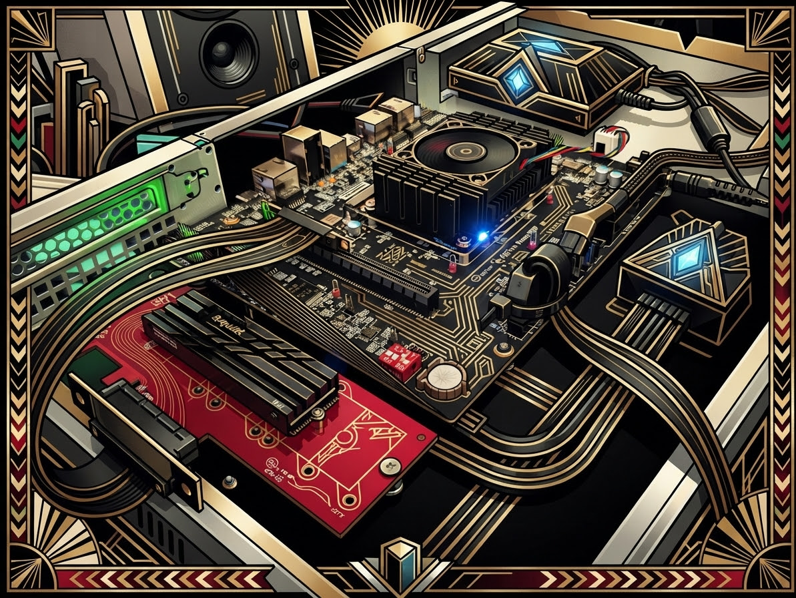
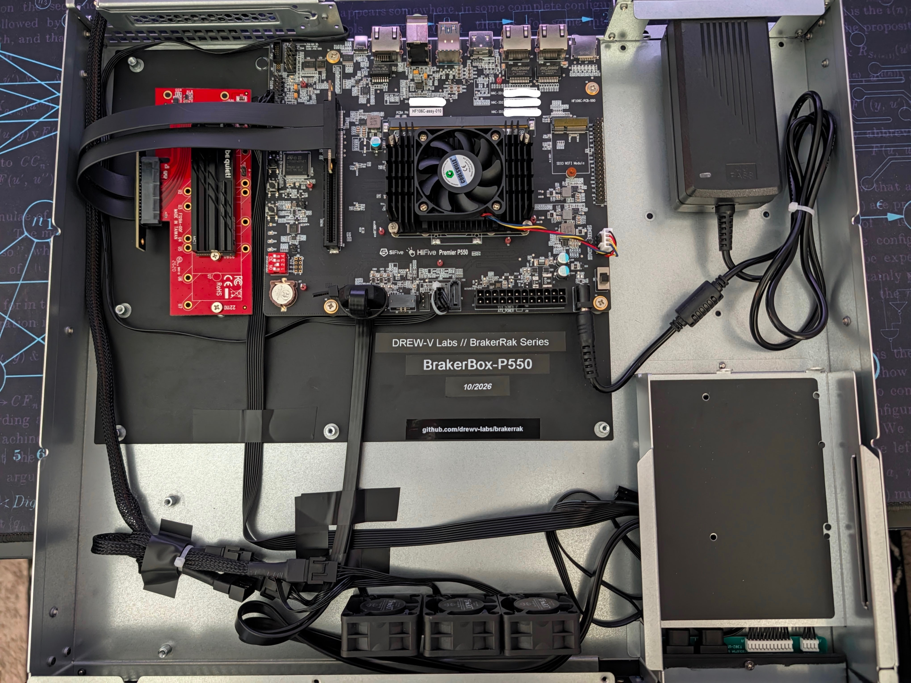

# BrakerBox-P550 

*Optimized SiFive HiFive Premier P550 Data Broker Build*

---

## 1. Architectural Overview

[DREW-V Labs](https://github.com/drewv-labs) presents this `brakerbox-p550` build as a 1U rackmount RISC-V high throughput data broker built around the **[SiFive HiFive Premier P550](https://www.sifive.com/development-platforms/hifive-premier-p550)** (`HF106-001`) Mini-DTX platform paired with a NVMe SSD (tested w/ WD_Black SN850X). Built on the latest PostgreSQL 18.6 `io_uring` functionality supporting up to 200 concurrent asynchronous NVMe disk I/O prefetch operations, 250 connected clients, and 4 parallel workers.

By switching to io_uring, PostgreSQL eliminates traditional synchronous blocking reads during large data scans and maintenance tasks. It establishes a shared ring buffer directly between user space and the Linux kernel, minimizing context switching and system call overhead.  

The BrakerBox-P550 also offers support for `custom RAID storage tiers`, `Mosquitto MQTT` brokering, & `NFSv4` hosting to cover all data brokering needs in the lab or out at the edge.

---

## 2. Hardware & 1U Mechanical Packaging

| Subsystem | Specification | Notes |
| :--- | :--- | :--- |
| **Board / SoC** | SiFive HiFive Premier P550 (`ESWIN EIC7700X`) | Mini-DTX (`203mm × 170mm`), STM32 Out-of-Band BMC |
| **CPU Complex** | 4x SiFive Performance P550 Cores @ 1.4GHz | 13-stage, 3-Wide OoO, `rv64imafdc_zicsr_zifencei_zba_zbb` |
| **Cache Hierarchy** | 32KB L1I + 32KB L1D / 256KB Private L2 / 4MB Shared L3 | SECDED ECC on L3 Cache |
| **System Memory** | 32GB LPDDR5-6400 | Soldered on SOM |
| **Boot / Root OS** | 128GB Soldered eMMC (`mmcblk0`) | Ubuntu 24.04 LTS (`multi-user.target` headless strip) |
| **Tier 0 (Hot NVMe)** | 2TB `WD_BLACK SN850X` (`nvme0n1`) + `be quiet! MC1` Heatsink | PCIe Gen3 x4 (`8.0 GT/s`), formatted to native `4096B` (`4Kn`) LBA |
| **PCIe Riser Assembly** | StarTech `PEX4M2E1` + Folded Twin-Axial PCIe x4 Ribbon Riser | Anchored to chassis floor via ATX standoff + elastomer isolation bumpers |
| **Tier 1 (Warm Vault)** | `WarmVault` — SilverStone 4-Bay USB 3.2 Gen 1 JBOD (External Bay 1) | 4x 12TB WD Red Plus CMR (native kernel `Btrfs RAID 10`, `compress=zstd:3,nofail`, `/mnt/warm_vault`) |
| **Tier 2 (Cold Archive)** | `ColdVault` — SilverStone 4-Bay USB 3.2 Gen 1 JBOD (External Bay 2) | 4x 6TB WD Blue (native kernel `Btrfs RAID 10`, `compress=zstd:3,nofail`, `/mnt/cold_vault`) |
| **Chassis & Power** | SilverStone `SST-RM100` (1U) + PicoPSU / Internal 12V Brick | 3x 40mm chassis fans controlled via Noctua NA-FC1 |

### USB Root Hub Topology Note
All external USB 3.2 Gen 1 ports on the HF106 carrier board sit behind a single **Synopsys DesignWare USB 3.0 Root Hub (`5000M` / ~450 MB/s shared bandwidth)**. High-concurrency transactional workloads (`PGDATA` and WAL) are strictly pinned to the PCIe Gen3 x4 `WD_BLACK SN850X` (`nvme0n1`), while `WarmVault` and `ColdVault` serve warm/cold tablespaces and bulk archives over the rear teal USB 3.2 Gen 1 ports.

---

## 3. Storage & PostgreSQL 18 Tuning Stack

### A. Native `4Kn` (`4096`-Byte) NVMe Alignment
Factory `WD_BLACK SN850X` drives ship in emulated `512e` (`512`-byte logical sector) mode. During Stage 1/2 of `forge.sh`, `nvme-cli` inspects the namespace capabilities (`lbads:12` -> `4096B`) and executes a low-level `nvme format` to native **`4Kn` (`4096`-byte)** sectors prior to LVM physical volume alignment (`--dataalignment 4m`) and XFS creation (`-s size=4096 -b size=4096`). This eliminates internal SSD controller Read-Modify-Write (RMW) translation penalties on PostgreSQL 8KB page flushes.

### B. Dual-LVM Elastic Pool & Snapshot Reserve
* **Single-LV / RAID-Backed Builds (`databench` or `WITH_RAID="true"`):** `forge.sh` allocates `85%VG` to `/dev/vg_braker/lv_pgdata` (`/mnt/nvme_pgdata`), reserving `15%VG` (~270GB) of unallocated extents for instant, zero-downtime LVM copy-on-write (CoW) snapshots between deterministic benchmark runs.
* **Single-NVMe NFS Builds (`ENABLE_NFS_SERVER="true"` & `WITH_RAID="false"`):** `forge.sh` provisions a **Dual-LVM** layout inside `vg_braker` (`rvdk mods/nvme-4kn --with-nfs-lv`), carving `/dev/vg_braker/lv_pgdata` (`/mnt/nvme_pgdata`, XFS) alongside `/dev/vg_braker/lv_nfsvault` (`/mnt/nfs_vault`, Btrfs) while retaining unallocated VG reserve extents for CoW snapshots and online elastic rebalancing (`brakerrak storage [status|grow-psql|grow-nfs|shrink-nfs|autotune]`).

### C. PostgreSQL 18 Drop-In Configuration (`99-rvdk-sifive-p550.conf`)
* **Async I/O Engine:** `io_method = io_uring` (auto-verified against `liburing` linkage and `kernel.io_uring_disabled = 0`)
* **Memory Allocation (32GB LPDDR5):** `shared_buffers = 8GB` (pinned via `vm.nr_hugepages = 4352` — `~4,352 × 2MB` Sv39 HugePages in `90-rvdk-pg18-hugepages.conf`, covering `8GB` shared buffers plus PostgreSQL metadata and `io_uring` ring overhead), `effective_cache_size = 24GB`, `work_mem = 64MB`, `maintenance_work_mem = 2GB`, `huge_pages = try`
* **RVA20 4-Hart OoO Execution:** `jit = off` (avoids LLVM JIT compilation overhead on scalar RVA20), `max_worker_processes = 8`, `max_parallel_workers = 4`, `max_parallel_workers_per_gather = 2`
* **WAL & Checkpoints:** `wal_compression = zstd`, `wal_buffers = 64MB`, `min_wal_size = 2GB`, `max_wal_size = 16GB`, `checkpoint_completion_target = 0.9`

---

## 4. Reference Telemetry & Benchmarks

### A. Zero-Cache PostgreSQL 18.6 Source Compilation (`perf stat`)
* **Target Silicon:** ESWIN EIC7700X (`4x SiFive P550` 3-Wide Out-of-Order harts @ `1.4 GHz`, `32GB LPDDR5`)
* **Compiler Flags:** `-O3 -pipe -march=rv64gc_zba_zbb -mcpu=sifive-p550 -mtune=sifive-p550`
* **Sustained IPC (`1.038`):** Retired **`4.54 trillion` instructions** across **`4.38 trillion` cycles** in `2,961.55s` (`49m 21.5s`).
* **Branch Predictor Accuracy (`95.72%`):** `659.07 billion` branches executed with only `28.24 billion` mispredictions (`4.28%` miss rate).

### B. PostgreSQL 18.6 `io_uring` I/O Torture Suite (Exploratory Single-Pass Baseline)
> **Methodology Note:** The table below reports **exploratory single-pass baseline measurements** (`N=1`) captured prior to multi-iteration statistical aggregation. Formal quantile characterization (`min` / `p50` / `p95` / `p99` across repeated cold-cache passes) is pending multi-iteration `brakerrak bench showdown --iterations 5 --analyze` runs processed by `benchmarks/analyze_showdown.py`.

Evaluated on a 50-million-row (`11 GB`, `1,351,353` pages) table on a `4Kn`-formatted `WD_BLACK SN850X` (`PCIe Gen3 x4`, `shared_buffers = 8GB` in `~4,352 × 2MB Sv39` HugePages) after cold-cache drop (`drop_caches = 3`):

| Workload & Metric | `sync` | `worker` | `io_uring` | `io_uring` + `O_DIRECT` |
| :--- | :--- | :--- | :--- | :--- |
| **Seq Scan Wall Time** | 15022 ms | 12776 ms | 13174 ms | — |
| **Seq Scan Backend I/O Wait** | 4017 ms | 112 ms | 32 ms | — |
| **Bitmap Scan Wall Time** | 54698 ms | 28530 ms | 35011 ms | 62482 ms |
| **Bitmap Scan Context Switches** | 24854 | 611038 | 508370 | 32189 |
| **Bitmap Scan L1d Cache Misses** | 4.75 B | 4.97 B | 4.93 B | 3.03 B |

To reproduce the `io_uring` + `O_DIRECT` column during a showdown run, pass `--with-direct-io`:
~~~bash
sudo brakerrak bench showdown --with-direct-io
~~~
`--with-direct-io` sets `debug_io_direct = 'data'` via `ALTER SYSTEM`, restarts PostgreSQL (verifying `pending_restart = 'f'`), and cleanly restores the baseline GUC on teardown.

---

## 5. Installation  

*See [BrakerRak README](https://github.com/drewv-labs/brakerrak) for full instructions.*  

Cheatsheet
~~~bash
# For BrakerBench-P550 Test Bench (NVMe-only)
curl -fsSL https://brakerrak.dev/forge.sh | sudo bash -s -- --role databench

# Full BrakerBox-P550 build (PG18 + Mosquitto MQTT + NFSv4)
curl -fsSL https://brakerrak.dev/forge.sh | sudo bash -s -- --role databroker
~~~

Then edit `/etc/brakerrak/node.env` to setup custom config and rerun to provision and validate the build...  
~~~bash
sudo brakerrak verify
~~~

---

## 1U Chassis Layout

  

---

## Reference `/etc/brakerrak/node.env` Config for Build Reproducibility

~~~bash
# ==============================================================================
# DREW-V Labs // BrakerBox-P550 Node Config (/etc/brakerrak/node.env)
# ==============================================================================
NODE_ROLE="databroker"
TARGET_HOSTNAME="brakerbox-p550"
ADMIN_USER="ubuntu"
LAB_SUBNET=""

# Hot NVMe Storage
NVME_DEV="/dev/nvme0n1"
MOUNT_POINT="/mnt/nvme_pgdata"
NFS_MOUNT_POINT="/mnt/nfs_vault"

# Optional USB/SATA Btrfs RAID 10 Arrays (Default: false / empty array)
WITH_RAID="true"
RAID_ARRAYS_JSON='[
  {
    "name": "WarmVault",
    "id": "warmvault",
    "type": "warm",
    "label": "WARM_VAULT",
    "mount": "/mnt/warm_vault",
    "disks": 4,
    "min_bytes": 11000000000000,
    "max_bytes": 13000000000000,
    "tablespace": "ts_warm_vault",
    "nfs_fsid": 10,
    "nfs_dirs": ["models/hailo8", "models/hailo8l", "models/hailo10h", "datasets", "benchmarks", "pg_backups", "ctd-vault"]
  },
  {
    "name": "ColdVault",
    "id": "coldvault",
    "type": "cold",
    "label": "COLD_VAULT",
    "mount": "/mnt/cold_vault",
    "disks": 4,
    "min_bytes": 5500000000000,
    "max_bytes": 6500000000000,
    "tablespace": "ts_cold_vault",
    "nfs_fsid": 20,
    "nfs_dirs": ["archives"]
  }
]'

# DataBroker Network Services (When ENABLE_NFS_SERVER=true and WITH_RAID=false, Dual-LVM carves lv_nfsvault and exports ${NFS_MOUNT_POINT})
ENABLE_MQTT_BROKER="true"
MQTT_PORT="1883"
ENABLE_NFS_SERVER="true"

# NFSv4 Server Backend: ganesha (default) | kernel (nfs-kernel-server override) | auto
NFS_BACKEND="ganesha"

~~~

---

**[DREW-V Labs](https://github.com/drewv-labs)**  // Indie Data Systems R&D   
`Simplicity in Architecture · Efficiency in Engineering · Purity in Science · Audacity in Art · Life in Logic`

