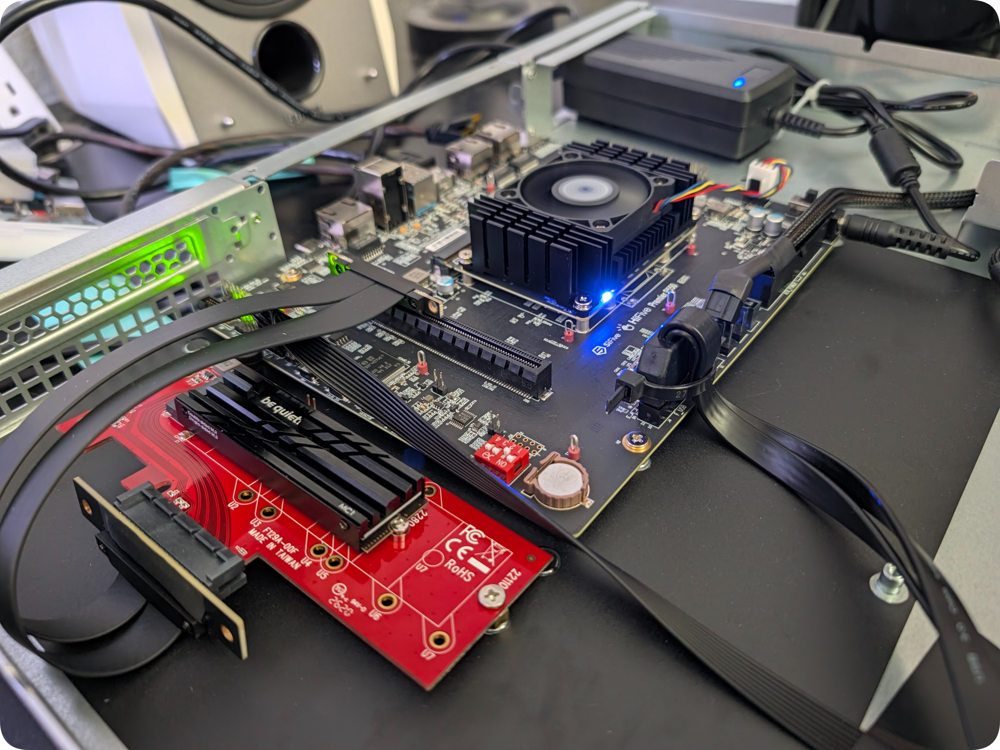

# DREW-V Labs BrakerBox-P550 

*Optimized SiFive HiFive Premier P550 Data Broker Build*

---

## 1. Architectural Overview

DREW-V Labs presents this `brakerbox-p550` build as a 1U rackmount RISC-V high throughput data broker built around the **[SiFive HiFive Premier P550](https://www.sifive.com/development-platforms/hifive-premier-p550)** (`HF106-001`) Mini-DTX platform paired with a NVMe SSD (tested w/ WD_Black SN850X). Built on the latest PostgreSQL 18.6 `io_uring` functionality supporting up to 200 concurrent asynchronous NVMe disk I/O prefetch operations, 250 connected clients, and 4 parallel workers.

By switching to io_uring, PostgreSQL eliminates traditional synchronous blocking reads during large data scans and maintenance tasks. It establishes a shared ring buffer directly between user space and the Linux kernel, minimizing context switching and system call overhead.  

The BrakerBox-P550 also offers support for custom RAID storage tiers, MQTT brokering, & NFS hosting to cover all data brokering needs.

---

## 2. Hardware & 1U Mechanical Packaging

| Subsystem | Specification | Notes |
| :--- | :--- | :--- |
| **Board / SoC** | SiFive HiFive Premier P550 (`ESWIN EIC7700X`) | Mini-DTX (`203mm × 170mm`), STM32 Out-of-Band BMC |
| **CPU Complex** | 4x SiFive Performance P550 Cores @ 1.4GHz | 13-stage, 3-Wide OoO, `rv64imafdc_zicsr_zifencei_zba_zbb` |
| **Cache Hierarchy** | 32KB L1I + 32KB L1D / 256KB Private L2 / 4MB Shared L3 | SECDED ECC on L3 Cache |
| **System Memory** | 32GB LPDDR5-6400 | Soldered on SOM |
| **Boot / Root OS** | 128GB Soldered eMMC (`mmcblk0`) | Ubuntu 24.04 LTS (`multi-user.target` headless strip) |
| **Tier 0 (Hot NVMe)** | 2TB `WD_BLACK SN850X` (`nvme0n1`) + `be quiet! MC1` Heatsink | PCIe Gen3 x4 (`8.0 GT/s`), formatted to native `4096B` (`4Kn`) LBA |
| **PCIe Riser Assembly** | StarTech `PEX4M2E1` + Folded Twin-Axial PCIe x4 Ribbon Riser | Anchored to chassis floor via ATX standoff + elastomer isolation bumpers |
| **Tier 1 (Warm Vault)** | `BigRed-WDR48` (`U08`) — SilverStone 4-Bay USB 3.2 Gen 1 | 4x 12TB WD Red Plus CMR (`mdadm` RAID 10, `/mnt/bigred_wdr48`) |
| **Tier 2 (Cold Archive)** | `LilBlu-WDB24` (`U09`) — SilverStone 4-Bay USB 3.2 Gen 1 | 4x 6TB WD Blue (`mdadm` RAID 10, `/mnt/lilblu_wdb24`) |
| **Chassis & Power** | SilverStone `SST-RM100` (1U) + PicoPSU / Internal 12V Brick | 40mm chassis fans controlled via Noctua NA-FC1; SOM active cooler idles at ~29°C @20°C ambient (ΔT ≈ 9°C) |

### USB Root Hub Topology Note
All external USB 3.2 Gen 1 ports on the HF106 carrier board sit behind a single **Synopsys DesignWare USB 3.0 Root Hub (`5000M` / ~450 MB/s shared bandwidth)**. High-concurrency transactional workloads (`PGDATA` and WAL) are strictly pinned to the PCIe Gen3 x4 `WD_BLACK SN850X` (`nvme0n1`), while `BigRed-WDR48` and `LilBlu-WDB24` serve warm/cold tablespaces and bulk archives over the rear teal USB 3.2 Gen 1 ports.

---

## 3. Storage & PostgreSQL 18 Tuning Stack

### A. Native `4Kn` (`4096`-Byte) NVMe Alignment
Factory `WD_BLACK SN850X` drives ship in emulated `512e` (`512`-byte logical sector) mode. During Stage 1/2 of `forge.sh`, `nvme-cli` inspects the namespace capabilities (`lbads:12` -> `4096B`) and executes a low-level `nvme format` to native **`4Kn` (`4096`-byte)** sectors prior to LVM physical volume alignment (`--dataalignment 4m`) and XFS creation (`-s size=4096 -b size=4096`). This eliminates internal SSD controller Read-Modify-Write (RMW) translation penalties on PostgreSQL 8KB page flushes.

### B. LVM Snapshot Reserve
`forge.sh` allocates `85%VG` to `/dev/vg_braker/lv_pgdata` (`/mnt/nvme_pgdata`), reserving `15%VG` (~270GB) of unallocated extents. This allows instant, zero-downtime LVM copy-on-write (CoW) snapshots to reset database state between deterministic benchmark runs.

### C. PostgreSQL 18 Drop-In Configuration (`99-brakerbox-p550.conf`)
* **Async I/O Engine:** `io_method = io_uring` (auto-verified against `liburing` linkage and `kernel.io_uring_disabled = 0`)
* **Memory Allocation (32GB LPDDR5):** `shared_buffers = 8GB`, `effective_cache_size = 24GB`, `work_mem = 64MB`, `maintenance_work_mem = 2GB`, `huge_pages = try`
* **RVA20 4-Hart OoO Execution:** `jit = off` (avoids LLVM JIT compilation overhead on scalar RVA20), `max_worker_processes = 4`, `max_parallel_workers = 4`, `max_parallel_workers_per_gather = 2`
* **WAL & Checkpoints:** `wal_compression = zstd`, `wal_buffers = 64MB`, `min_wal_size = 2GB`, `max_wal_size = 16GB`, `checkpoint_completion_target = 0.9`

---

## 4. Installation  

*See [BrakerRak README](https://github.com/drewv-labs/brakerrak) for full instructions.*  

Cheatsheet
~~~bash
# For BrakerBench-P550 Test Bench (NVMe-only)
curl -fsSL https://brakerrak.dev/forge.sh | sudo bash

# Full BrakerBox-P550 build (PG18 + Mosquitto MQTT + NFSv4)
curl -fsSL https://brakerrak.dev/forge.sh | sudo bash -s -- --role databroker
~~~

Then edit `~/.brakerrak/node.env` to setup custom config and rerun to provision and validate the build...  
~~~bash
sudo brakerrak verify --role databroker --use-pkg-cache
~~~

---

**DREW-V LABS** // **Drew Vandagriff** — *Dallas, TX*  
`Simplicity in Architecture · Efficiency in Engineering · Purity in Science · Audacity in Art · Life in Logic`

