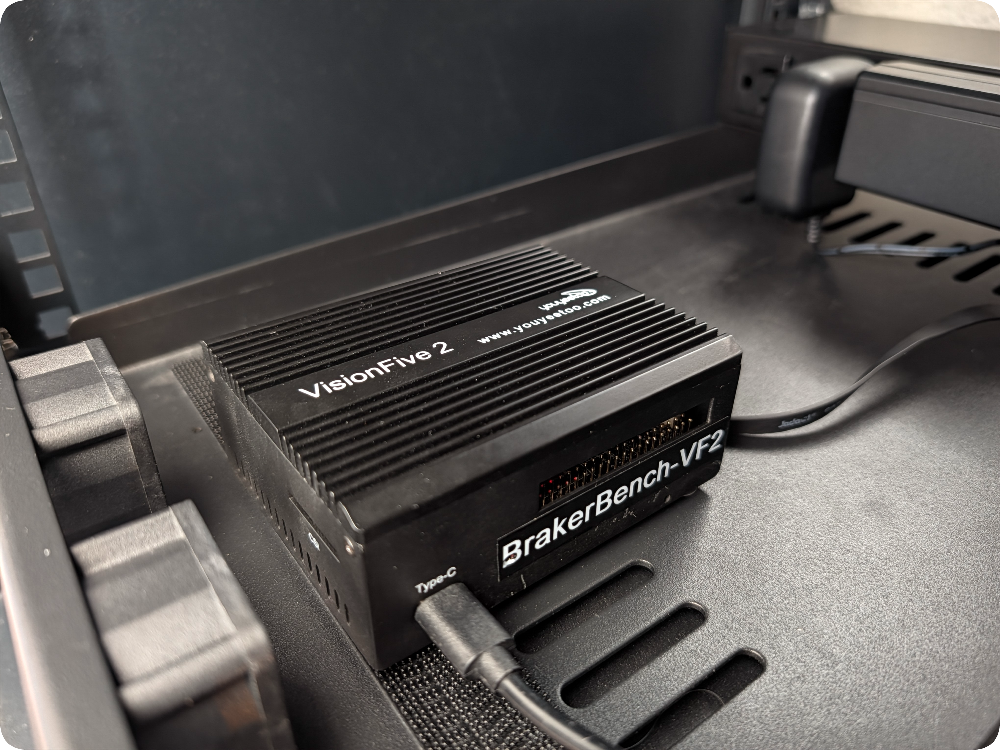

# DREW-V Labs BrakerBench-VF2

*Optimized StarFive VisionFive 2 (JH7110) Data Bench Build*

  

---

## 1. Architectural Overview

DREW-V Labs presents this `brakerbench-vf2` build as a 1U rack-shelf RISC-V relational benchmark testbed and edge data broker built around the **[StarFive VisionFive 2](https://www.starfivetech.com/en/index.php?s=hardware&c=show&id=14)** (`JH7110`) platform paired with an M.2 NVMe SSD (tested w/ `WD_BLACK SN750` 2TB). Built on the latest PostgreSQL 18.6 `io_uring`, it serves as the canonical **2-Wide In-Order (`InO`)** baseline against the **3-Wide Out-of-Order (`OoO`)** [`BrakerBox-P550`](../sifive-p550/README.md).

By switching to `io_uring`, PostgreSQL eliminates traditional synchronous blocking reads during large data scans and maintenance tasks. It establishes a shared ring buffer directly between user space and the Linux kernel, minimizing context switching and system call overhead—critical on Dual-Issue In-Order `SiFive U74` harts where syscall traps and `io worker` IPC stalls cannot be hidden behind out-of-order speculative execution.

When provisioned with `--role databroker` (`BrakerBox-VF2`), this target also offers full support for `custom RAID storage tiers` (`mdadm` XFS or native kernel `Btrfs RAID 10`), `Mosquitto MQTT` brokering, & `NFSv4` hosting to cover standalone edge data brokering needs.

---

## 2. Hardware & 1U Mechanical Packaging

| Subsystem | Specification | Notes |
| :--- | :--- | :--- |
| **Board / SoC** | StarFive VisionFive 2 (`StarFive JH7110`) | Compact SBC (`100mm × 72mm`), Dual RGMII GbE (`eth0` / `eth1`) |
| **CPU Complex** | 4x SiFive U74 Cores @ 1.5GHz (+ 1x S7 Monitor Core) | 8-stage, 2-Wide Dual-Issue In-Order (`InO`), `rv64imafdc_zicsr_zifencei_zba_zbb` |
| **Cache Hierarchy** | 32KB L1I + 32KB L1D / 2MB Shared L2 (`CCACHE`) | Coherent L2 cache controller w/ hardware PMU event counters |
| **System Memory** | 8GB LPDDR4-2800 | 32-bit bus, soldered on PCB |
| **Boot / Root OS** | 16MB QSPI NOR (`SPL` + `U-Boot`) + microSD / eMMC | Debian Headless (`riscv64`, `multi-user.target` headless strip) |
| **Tier 0 (Hot NVMe)** | 2TB `WD_BLACK SN750` (`nvme0n1`) | Underside M.2 M-Key (`2280`), PCIe Gen2 x1 (`5.0 GT/s`), native `4096B` (`4Kn`) LBA |
| **Optional RAID Tiers** | Configurable via `RAID_ARRAYS_JSON` (`--with-raid`) | External USB 3.0 4-Bay JBOD (`mdadm` RAID 10 + XFS or native `Btrfs RAID 10`) |
| **Thermal Armor** | `youyeetoo` Passive Finned Aluminum Enclosure | Under-PCB shelf cutouts for direct airflow across underside M.2 NVMe |
| **Chassis & Cooling** | 1U Vented Honeycomb Shelf (`U02`) + USB-C PD | 5x 40mm front-intake PWM fans controlled via Noctua `NA-FC1` |

### PCIe 2.0 & VL805 USB 3.0 Bus Topology Note
The StarFive `JH7110` SoC exposes two independent single-lane **PCIe Gen2 x1 (`5.0 GT/s` / ~450 MB/s)** controllers:
* **`PCIe1` (Underside M.2 M-Key):** Dedicated exclusively to the `WD_BLACK SN750` NVMe (`nvme0n1`), providing an uncontended point-to-point link for `PGDATA` and WAL traffic.
* **`PCIe0` (Onboard VIA Labs `VL805` xHCI Bridge):** Multiplexes all four external Type-A USB 3.0 ports across a single PCIe Gen2 x1 lane. In `BrakerBench-VF2` (`databench`) mode, USB RAID, MQTT, and NFS daemons remain disabled to guarantee zero interrupt jitter during microarchitectural ablations; in `BrakerBox-VF2` (`databroker`) mode, warm/cold USB RAID 10 tablespaces traverse `PCIe0` without stealing bandwidth from `PCIe1` NVMe transactions.

---

## 3. Storage & PostgreSQL 18 Tuning Stack

### A. Native `4Kn` (`4096`-Byte) NVMe Alignment & Filesystem Adaptation
Factory `WD_BLACK` NVMe drives ship in emulated `512e` (`512`-byte logical sector) mode. During Stage 1/2 of `forge.sh`, `nvme-cli` inspects the namespace capabilities (`lbads:12` -> `4096B`) and executes a low-level `nvme format` to native **`4Kn` (`4096`-byte)** sectors prior to LVM physical volume alignment (`--dataalignment 4m`). `forge.sh` formats the logical volume as `XFS` (`-s size=4096 -b size=4096`) when `xfs.ko` is present, or seamlessly falls back to `4K`-aligned `ext4` (`-b 4096`) on stripped custom JH7110 kernels compiled without `CONFIG_XFS_FS`. This eliminates internal SSD controller Read-Modify-Write (RMW) translation penalties on PostgreSQL 8KB page flushes.

### B. LVM Snapshot Reserve
`forge.sh` allocates `85%VG` to `/dev/vg_braker/lv_pgdata` (`/mnt/nvme_pgdata`), reserving `15%VG` (~270GB) of unallocated extents. This allows instant, zero-downtime LVM copy-on-write (CoW) snapshots to reset database state between deterministic benchmark runs.

### C. PostgreSQL 18 Drop-In Configuration (`99-brakerbench-vf2.conf`)
* **Async I/O Engine:** `io_method = io_uring` (auto-verified against `liburing` linkage and `kernel.io_uring_disabled = 0`)
* **Memory Allocation (8GB LPDDR4):** `shared_buffers = 2GB` (pinned in `1,152 × 2MB Sv39` HugePages), `effective_cache_size = 6GB`, `work_mem = 32MB`, `maintenance_work_mem = 512MB`, `huge_pages = try`
* **RVA20 4-Hart In-Order Execution:** `jit = off` (avoids LLVM JIT compilation overhead on scalar 2-wide In-Order `U74`), `max_worker_processes = 8`, `max_parallel_workers = 4`, `max_parallel_workers_per_gather = 2`
* **WAL & Checkpoints:** `wal_compression = zstd`, `wal_buffers = 64MB`, `min_wal_size = 2GB`, `max_wal_size = 16GB`, `checkpoint_completion_target = 0.9`

---

## 4. Reference Telemetry & Benchmarks

### A. Zero-Cache PostgreSQL 18.6 Source Compilation (`perf stat`)
* **Target Silicon:** StarFive JH7110 (`4x SiFive U74` 2-Wide In-Order harts @ `1.5 GHz`, `8GB LPDDR4`)
* **Compiler Flags:** `-O3 -pipe -march=rv64gc_zba_zbb -mcpu=sifive-u74 -mtune=sifive-u74`
* **Sustained IPC (`TBD`):** Retired **`TBD`** instructions across **`TBD`** cycles in `TBD` (`TBD`).
* **Branch Predictor Accuracy (`TBD`):** `TBD` branches executed with `TBD` mispredictions (`TBD` miss rate).

### B. PostgreSQL 18.6 `io_uring` I/O Torture Suite (Preliminary Baseline)
Evaluated on a 50-million-row (`11 GB`, `1,351,353` pages) table on a `4Kn`-formatted `WD_BLACK SN750` (`PCIe Gen2 x1`, `shared_buffers = 2GB` in `2MB Sv39` HugePages) after cold-cache drop (`drop_caches = 3`):

| Workload & Metric | `sync` | `worker` | `io_uring` | `io_uring` + `O_DIRECT` |
| :--- | :--- | :--- | :--- | :--- |
| **Seq Scan Wall Time** | — | — | — | — |
| **Seq Scan Backend I/O Wait** | — | — | — | — |
| **Bitmap Scan Wall Time** | — | — | — | — |
| **Bitmap Scan Context Switches** | — | — | — | — |
| **Bitmap Scan L1d Cache Misses** | — | — | — | — |

---

## 5. Installation

*See [BrakerRak README](https://github.com/drewv-labs/brakerrak) for full instructions.*

Cheatsheet
~~~bash
# For BrakerBench-VF2 Test Bench (NVMe-only)
curl -fsSL https://brakerrak.dev/forge.sh | sudo bash

# Full BrakerBox-VF2 build (PG18 + Mosquitto MQTT + NFSv4)
curl -fsSL https://brakerrak.dev/forge.sh | sudo bash -s -- --role databroker
~~~

Then edit `~/.brakerrak/node.env` to setup custom config and rerun to provision and validate the build...
~~~bash
sudo brakerrak verify --use-pkg-cache
~~~

---

**DREW-V LABS** // **Drew Vandagriff** — *Dallas, TX*  
`Simplicity in Architecture · Efficiency in Engineering · Purity in Science · Audacity in Art · Life in Logic`

